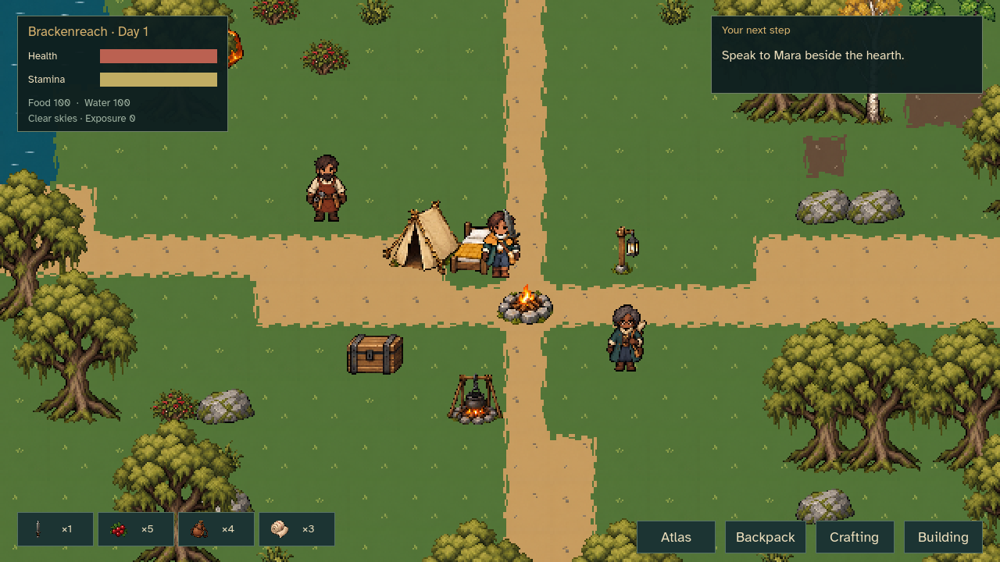

# The Mossbound Atlas

**Find a path. Make a home. Bring the world together.**

An offline, single-player pixel art wilderness RPG. Follow forgotten roads through five regions, build camps and gardens, trade with travelers, and restore an ancient network of waystones. Shape each region through **Bloom**, **Ember** or **Gale**. Face its warden, or choose Peaceful and make a restoration offering.

[Download for Windows](https://github.com/ProgrammingWithYagle/Open_World_Survival_RPG_CODEX/releases/latest) · [Player Wiki](docs/wiki/Home.md) · [Changelog](CHANGELOG.md) · [Controls and installation](docs/PLAYING.md)



## What you can do

- Explore a seeded 1,024 × 1,024 tile world with five regional wardens and 30 discovery sites: caches, surveys, memory seals, springs, groves and repeatable expeditions.
- Make equipment, food and settlements using **143 items, 115 recipes and 41 building pieces**. Foundations, furniture, gardens, processing stations, storage and courier routes work together.
- Grow six crops, catch five regional fish, prepare meals and cordials, equip six charms, and learn nine perks. Build a grain-to-bread supply chain or supply a distant outpost.
- Meet eight travelers, earn goodwill through 16 rotating requests, and record 25 creatures in your field guide. Three-wave expeditions increase in depth as you complete them.
- Choose five game difficulties independently from Easycore, Mediumcore or Hardcore death rules. Multiple journey slots, automatic saves and three backup generations preserve progress. A retired Hardcore character's atlas remains readable.

English, 简体中文, 繁體中文, Español and 日本語 are included. All 642 player text keys have separate catalogs, and Chinese and Japanese fonts ship with the game. Keyboard/mouse and controller bindings are available. The in-game changelog is generated from the same release data as the repository reference.

## Play

Download the Windows ZIP from Releases, **extract the entire folder**, then launch `The Mossbound Atlas.exe`. Keep the adjacent `.pck` file with it. An engine installation, account and network connection are unnecessary. Read [the quick start](docs/PLAYING.md) for controls, saves and the first objective.

From source, use **Godot 4.5.1**. Open `godot/project.godot`, let imports finish and run `scenes/Mossbound.tscn`. The Compatibility renderer draws the world at 640 × 360 beneath a separate readable interface.

## Development

Gameplay lives in `godot/scripts/core`, `world`, `actors` and `ui`. JSON content is under `godot/data`; translations are under `godot/locale`. The authored builders in `tools` regenerate content, Wiki pages, audio and normalized sprites. Original source artwork, hashes and font licenses are retained.

```powershell
python -m pip install -r requirements-dev.txt
python -m pytest tests
python tools/build_wiki.py --check
python tools/check_docs.py
python tools/check_godot.py --godot C:/path/to/Godot_console.exe
python tools/build_windows.py --godot C:/path/to/Godot_console.exe
python tools/verify_download.py exports/The-Mossbound-Atlas-1.0.0-Windows-x64.zip
```

The five CI jobs validate data, assets, Godot gameplay, Windows packaging and documentation. Native visual suites cover five languages and normal/quarter-speed animation playback. See [verification and limitations](docs/IMPLEMENTATION_STATUS.md), [design research](docs/DESIGN_RESEARCH.md), [asset provenance](docs/ASSETS.md) and [the development board](docs/PROJECT.md).

This is an original revamp of the earlier repository prototype. The art uses image generation followed by deterministic preparation, inspection and revisions; it is not represented as hand-drawn. Music and effects use original note sequences and synthesis. No commercial game art or music is bundled. Source is MIT licensed; bundled fonts and engine notices retain their own licenses.
